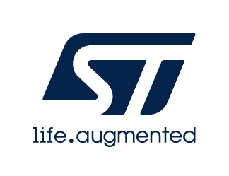

# Release Notes for 
# <mark>IS42S32800J Component Driver </mark>
Copyright &copy; 2023 STMicroelectronics\
    

# Purpose

This driver provides a set of SDRAM functions offered by IS42S32800J component

# Update History

<label for="collapse-section2" aria-hidden="true">__V1.0.1 / 11-September-2026__</label>

## Main Changes

-	Clarify that the SDRAM **REFRESH_COUNT** value depends on the actual SDRAM clock frequency.

<label for="collapse-section1" aria-hidden="true">__V1.0.0 / 30-October-2019__</label>

			

## Main Changes

-	First official release of **IS42S32800J** SDRAM Component drivers in line with STM32Cube BSP drivers development guidelines (UM2298)

For complete documentation on <mark>STM32 Microcontrollers</mark> ,
visit: [[www.st.com](http://www.st.com/STM32